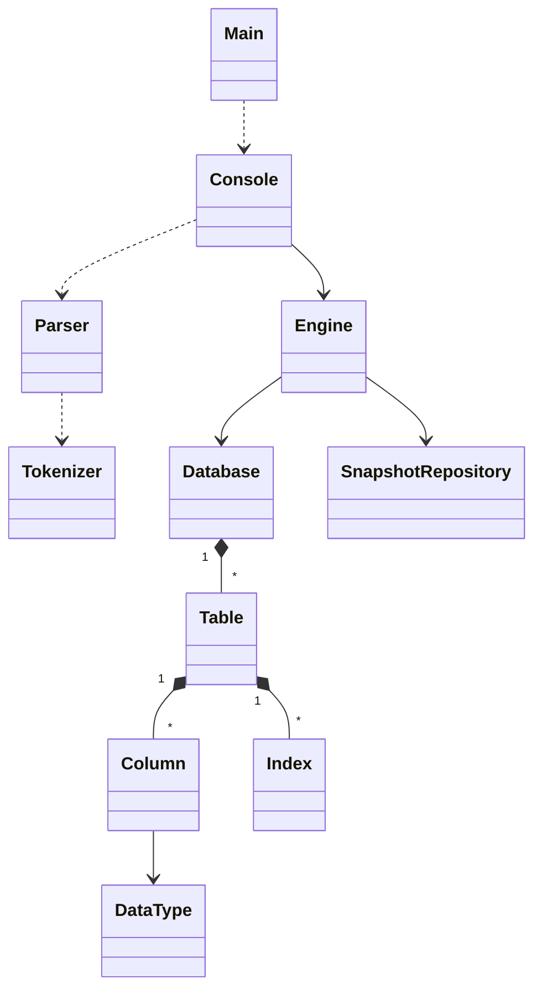
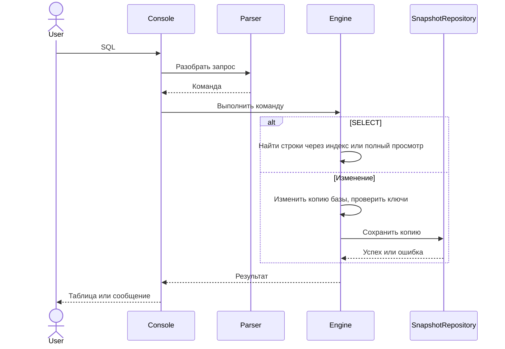

## Запуск

Нужны JDK 17+ и Maven 3.9+. Команды выполняются из папки с `pom.xml`.

```sh
git clone https://github.com/looneytop/simpleDBMS.git
cd simpleDBMS
mvn clean package
```

При первом запуске база пустая. Создать таблицы и загрузить пример данных:

```sh
java -jar target/simple-db-1.0.jar --data data/demo < examples/demo.sql
```

Открыть эту базу:

```sh
java -jar target/simple-db-1.0.jar --data data/demo --diagnostics
```

После `sql>` вводятся запросы с `;` в конце. Выход — `exit`.
`--diagnostics` показывает способ поиска и число проверенных строк.
Без `--data` используется каталог `data/`.

Демонстрационный сценарий выполняется один раз для пустого хранилища.
Он создаёт `brands` и `cars`, выполняет несколько изменений и оставляет
BMW с id=2 и Ford с id=3. Повторно загружать сценарий при запуске не нужно.

## Команды

Типы столбцов: `INT`, `DOUBLE`, `STRING`, `DATE`, `BOOLEAN`.
Строки и даты заключаются в одинарные кавычки. Формат даты — `yyyy-MM-dd`.
Апостроф внутри строки удваивается: `'O''Brien'`.

В примере `brands.name` — первичный ключ марки, `cars.id` — первичный ключ
автомобиля, `cars.brand` — внешний ключ на `brands.name`.

После загрузки примера можно выполнить:

```sql
INSERT INTO cars VALUES (5, 'Toyota', 25000.0, TRUE);
INSERT INTO cars (id, brand) VALUES (6, 'BMW');
INSERT INTO cars VALUES (7, 'Ford', 18000.0, FALSE), (8, 'BMW', 22000.0, TRUE);
SELECT * FROM cars;
SELECT brand, price FROM cars WHERE price > 20000;
UPDATE cars SET price = 30000 WHERE id = 6;
DELETE FROM cars WHERE brand = 'Toyota';
```

Создание таблицы и индекса:

```sql
CREATE TABLE notes (id INT PRIMARY KEY, text STRING, created DATE);
INSERT INTO notes VALUES (1, 'Запись', '2026-11-15');
CREATE INDEX idx_notes_created ON notes (created);
SELECT * FROM notes WHERE created >= '2026-11-01';
DROP TABLE notes;
```

Внешний ключ задаётся при создании столбца: `brand STRING REFERENCES brands(name)`.
Первичный ключ обязателен, уникален и не может быть `NULL`. Нельзя удалить
родительскую запись или изменить её ключ, пока на неё ссылаются.
`DROP TABLE` также запрещён при ссылках из другой таблицы.

`WHERE` поддерживает одно условие с `=`, `!=`, `<>`, `>`, `>=`, `<`, `<=`.
Для BOOLEAN доступны только равенство и неравенство. Ключевые слова и имена
не зависят от регистра, строковые значения — зависят.

Пропущенные непервичные столбцы при `INSERT` получают `NULL`. Сравнения с `NULL`
не дают совпадений. `UPDATE` и `DELETE` без `WHERE` затрагивают все строки.
Ошибка отклоняет весь запрос. Результат SELECT выводится таблицей.

## Архитектура

`Console` читает и выводит команды, `Tokenizer` выделяет токены, `Parser`
создаёт объекты запросов. `Engine` выполняет их и проверяет ограничения.
`Database` содержит схемы и строки, `DataType` проверяет типы,
`Index` отвечает за поиск, `SnapshotRepository` — за файловое хранение.
Хранилище отделено от движка по принципу Repository.





## Хранение и индексы

База сериализуется после каждого изменения в `database.bin` и загружается
при запуске. Новый снимок сначала записывается во временный файл, затем
заменяет основной. `database.bak` хранит предыдущее состояние. Если основной
файл повреждён, программа пробует резервный и сообщает о восстановлении.
Последнее изменение при этом может быть потеряно. Два процесса с одной базой
одновременно не поддерживаются.

Индекс — `TreeMap`, где значению столбца соответствует набор первичных ключей.
Он обновляется при INSERT, UPDATE и DELETE и сохраняется вместе с базой.
SELECT использует индекс для `=`, `>`, `>=`, `<`, `<=` по индексированному
столбцу. Строки получаются по первичным ключам без повторного полного просмотра.
Для остальных случаев выполняется полный просмотр.

## Производительность

```sh
java -Xms256m -Xmx1g -cp target/simple-db-1.0.jar lab.Benchmark
```

Данные генерируются с `Random(42)`. Для каждого запроса выполняются 30 пар
прогрева и 21 пара измерений с чередованием SCAN/INDEX. Сравниваются медианы.
Измеряются поиск и формирование результата SELECT; подготовка данных,
построение индекса, разбор SQL, запись на диск и вывод исключены.
Результаты обоих способов поиска проверяются на совпадение.

Замеры от 15 ноября 2026 года: macOS aarch64, OpenJDK Zulu 21.0.11,
компиляция под Java 17. Время в миллисекундах.

| Строк | Условие | Найдено | Без индекса | С индексом |
| ---: | --- | ---: | ---: | ---: |
| 10 000 | value = 500 | 5 | 0.155 | 0.004 |
| 10 000 | value >= 990 | 104 | 0.193 | 0.025 |
| 10 000 | value >= 100 | 8 953 | 0.519 | 0.716 |
| 100 000 | value = 500 | 115 | 1.137 | 0.006 |
| 100 000 | value >= 990 | 1 077 | 0.418 | 0.050 |
| 100 000 | value >= 100 | 89 994 | 1.493 | 10.479 |

Исходный вывод: [benchmarks/results.txt](benchmarks/results.txt).
Время зависит от нагрузки компьютера и работы JVM.

## Выводы

Индекс ускоряет поиск небольшой части строк. На широком диапазоне полный
просмотр может быть быстрее из-за затрат на сбор ключей и получение строк.
Движок выбирает индекс по наличию и не оценивает избирательность условия.

Сохранение полного снимка упрощает восстановление, но делает частые одиночные
вставки дорогими. Вся база находится в памяти. Поддерживается только описанное
подмножество SQL: без JOIN, AND/OR, вложенных запросов и агрегатных функций.

## Источники

- Задание лабораторной работы № 2.
- [Java SE 17: TreeMap](https://docs.oracle.com/en/java/javase/17/docs/api/java.base/java/util/TreeMap.html).
- [Java SE 17: ObjectOutputStream](https://docs.oracle.com/en/java/javase/17/docs/api/java.base/java/io/ObjectOutputStream.html).
- [Java SE 17: Files](https://docs.oracle.com/en/java/javase/17/docs/api/java.base/java/nio/file/Files.html).
